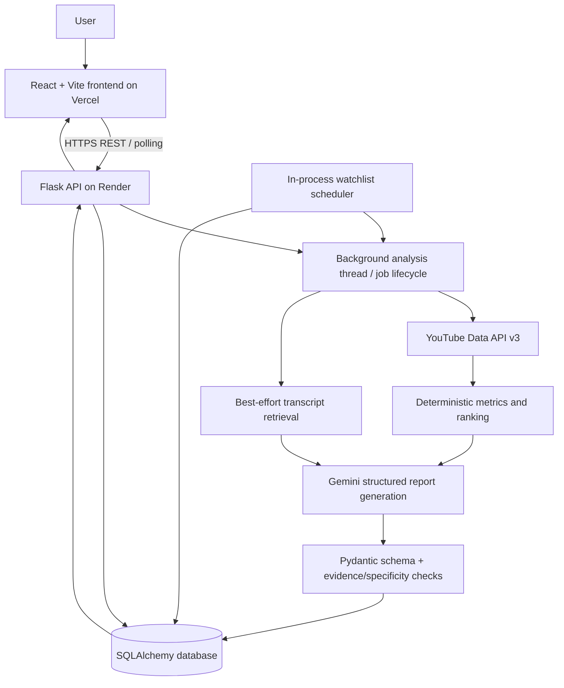

# Architecture — Wilmarcs YouTube Video Presence Analyser

## Purpose and current deployment

The application analyses public YouTube channel metadata and available transcripts, calculates deterministic metrics, and asks Gemini to produce a structured, evidence-aware report. The React/Vite frontend is deployed on Vercel; the Flask API is deployed on Render.

- Frontend: https://wilmarcs-assignment.vercel.app
- API base: https://wilmarcs-assignment.onrender.com/api
- Source: https://github.com/Harsha-k04/wilmarcs-assignment

## Component diagram

## Request and analysis flow

1. The frontend submits a public channel URL/handle to `POST /api/analyses`.
2. Flask validates the input, creates an `AnalysisJob`, returns a job ID with HTTP 202, and starts a daemon thread.
3. The worker marks the job `processing`, resolves the channel and retrieves a bounded recent set of videos through YouTube Data API v3. Transcript retrieval is best-effort.
4. Python calculates metrics and ranks videos from available data. Engagement is `(likes + comments) / views`; zero or missing denominators should be represented as unavailable, not invented.
5. Gemini generates a structured report. Pydantic checks field types and score bounds; additional logic checks transcript evidence and video-specific feedback. A valid report is persisted and the job becomes `done`; exceptions/timeouts produce `failed`.
6. The frontend polls the job endpoint and displays the report or an error. History, watchlist and alerts use separate REST endpoints.

## Stack rationale and boundaries

- **React + Vite:** lightweight dashboard and asynchronous status updates.
- **Flask:** small REST API, validation and orchestration with Python libraries.
- **YouTube Data API v3:** official source for public metadata; requests must be bounded and quota-aware.
- **Transcript retrieval:** enriches analysis when captions are available; missing transcripts should not block metadata-only analysis.
- **Gemini + Pydantic:** structured language-model output is validated before it is accepted.
- **SQLAlchemy:** persistence abstraction supporting SQLite for local development and PostgreSQL through `DATABASE_URL`.

This prototype does not analyse actual video frames or audio tracks. Metadata and transcripts cannot substantiate claims about editing, shot composition, pacing, audio quality or visual storytelling. Such scores should be marked unavailable when the required evidence is absent.

## Watchlist and alert behaviour

The scheduler checks due watchlist entries. The first successful check establishes a baseline; it should not alert for videos that were already present. Later checks compare video IDs and available metrics. Current code uses 1.5x / 0.5x of the channel average for early-performance alerts and requires a score change of at least two points to be confirmed across consecutive successful checks. These are prototype thresholds, not universal performance rules. A recorded check timestamp alone is not proof that an alert was detected, persisted and shown.

## Hosting and operational caveats

- Vercel uses `VITE_API_BASE_URL=https://wilmarcs-assignment.onrender.com/api`; the URL is public configuration, not a secret.
- Render must allow the exact Vercel origin in `CORS_ORIGINS`.
- The API defaults to SQLite if `DATABASE_URL` is missing. An ephemeral host filesystem can lose SQLite data on restart/redeploy; configure a managed PostgreSQL database and verify persistence before relying on history or alerts.
- The scheduler runs in the web process. A free web service may sleep when idle, so scheduled checks are not reliable while asleep. For production, run a separate durable worker/scheduler, use a queue, add locking/idempotency, and monitor failed checks.
- API calls need timeouts, bounded retries/backoff, quota-aware limits, and safe error categories.

## Extending the design

### Instagram Reels
Add a separate adapter using Meta's official Instagram Graph API for eligible professional accounts. Access depends on app configuration, permissions and account ownership. Normalize permitted metadata and insights into a shared internal schema, while preserving Instagram-specific metric definitions and handling token expiry, rate limits and permission changes.

### LinkedIn video
Add a LinkedIn adapter using approved APIs, OAuth scopes and the correct member/organization role. API access to organization content and analytics is permission-dependent. Keep LinkedIn metric definitions and reporting windows distinct.

### Actual media analysis
For authorized media, sample frames at fixed intervals and scene changes, extract on-screen text, transcribe speech and measure audio/pacing proxies. Store the provenance of each signal and clearly distinguish direct observations from proxies. Respect platform terms, copyright, consent and storage limits.

### Scale to 500 channels/day
The first likely bottlenecks are YouTube quota, transcript retrieval and AI provider throughput/latency. Add metadata caching and deduplication, per-channel limits, a durable queue and worker pool with bounded concurrency, a separate scheduler, distributed locks/idempotency keys, PostgreSQL indexes/batched writes, retention policies, structured logs, latency/quota metrics and failed-job/dead-letter handling.
